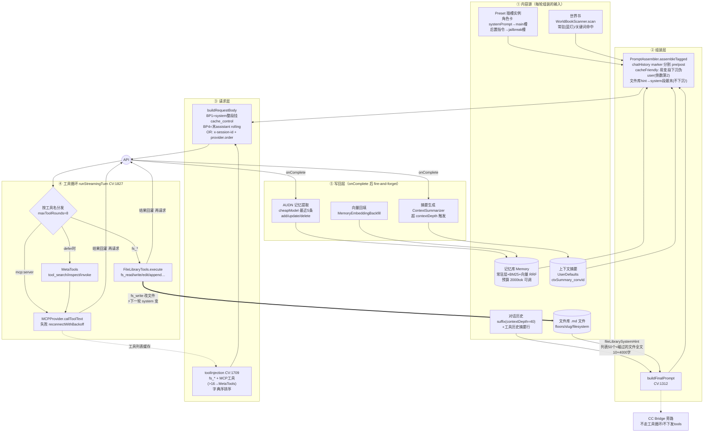
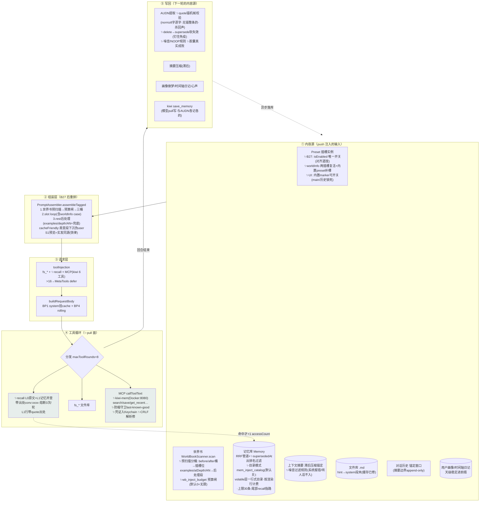

# Research: 上下文供应链拓扑 — 上下文管理 × 文件库 × MCP × 记忆库

> 2026-06-11 · 方法：3 路并行代码扫描 + 关键结论本人逐行核实（B21 接线状态、文件库注入位置、cacheFriendly 下沉逻辑均亲核行号）
> 背景：粟粟决定 sprint 聚焦四块核心功能，要求先画拓扑、定边界、防互相打架。
> ⚠️ 并行约束：另一 session 正在重做上下文压缩（S3），本文档描述的是 master 当前状态；ContextSummarizer / 组装注入口的部分以那边的 plan 为准。
> 关联文档：`docs/体检/CODE_REVIEW.md` / `REFACTOR_PLAN.md` / `docs/roadmap-memory-system.md` / `docs/PROJECT_ROADMAP.md`

---

## 一、一张图：上下文供应链是个闭环

四块功能不是四个独立 feature——它们是同一条链的四段：**内容源 → 组装 → 请求 → 工具循环 → 写回 → 下一轮的内容源**。打架都发生在段与段的接缝上。

**闭环含义**：fs_write 写的文件、AUDN 提取的记忆、生成的摘要，下一轮全部变回组装输入。所以"打架"不只是运行时抢资源——**任何一个写回动作都会改变下一轮的 prompt 前缀**，缓存、预算、语义重复三类问题都从这里来。

## 二、节点速查（关键行号）

| 节点 | 文件:行号 | 一句话 |
|------|----------|--------|
| 插槽排序+marker 分割 | PromptAssembler.swift:87-94, Preset.swift:75-95 | injectionOrder 升序，chatHistory marker 前后分 pre/postHistory |
| 记忆拆稳定/易变两层 | PromptAssembler.swift:112-131, MemoryService.swift:365-429 | stable 留 system 前缀，volatile 下沉 |
| 检索器管道 (M1/M2) | MemoryService.swift:183-360 | 常驻(tier0,createdAt稳定排序)/BM25/向量(阈值0.35)/全量兜底，RRF 融合 |
| 世界书扫描 | WorldBookScanner.swift:22-119 | 常驻全命中；关键词扫 scanDepth=10；cacheFriendly 时关键词条目下沉 |
| 摘要注入 | PromptAssembler.swift:241-249 | cacheFriendly 下沉，否则 preHistorySystem |
| 易变段并伪 user | PromptAssembler.swift:263-270 | 插历史倒数第 2，前缀(system+历史)逐字稳定 |
| **文件库 hint** | PromptAssembler.swift:272-278, CV:1780-1804 | **system 段最末，cacheFriendly 也不下沉** |
| 工具数组组装 | CV:1709-1747 | fs_*+MCP 字典序；MCP>16 → MetaTools defer |
| cache 挂标 | ChatService.swift:727-749(Anthropic), 379-395(OR) | BP1=system 整段 + BP4=末 assistant；4xx 黑名单自愈 |
| 工具循环 | CV:1827-1977 | 分发 fs_*/mcp/meta，≤8 轮，segments 落盘 |
| turn 状态/排队 | CV:1174-1261 | assistantTurnInFlight + pendingSends 串行 drain（B16 修复）|
| 记忆提取 | CV:2055-2161, MemoryService.swift:649-750 | onComplete 后异步，mem_master+对话级双闸，budgetGate |
| 摘要生成 | ContextSummarizer.swift:38-205 | 超 contextDepth 触发，增量合并，budgetGate |
| 文件库执行+防护 | FileLibraryTools.swift, FileLibraryStore.swift:85-95 | 路径越狱防护；diff 截 80 行 |
| MCP 工具列表 | MCPProvider.swift:215-250 | **用缓存列表不要求 live 连接**（防 iOS 后台抖动）|
| CC Bridge 旁路 | CV:1585-1590, ChatService.swift:1146-1162 | 斜杠命令直发 hub；不支持 tools，只发最后一条 user |

## 三、打架点清单（核心交付）

### 运行时打架

#### 🔴 A1 · 文件库 hint × prompt cache（实锤，有行号证据）

- **机制**：文件库 hint（文件列表 + 本对话碰过文件的**当前全文**，最多 10×4000 字，CV:1780-1804）是 system 段（PromptAssembler.swift:272-278），且 cacheFriendly 时**不在下沉名单里**（记忆/世界书/摘要/时间宏都下沉了，唯独它没有）。Anthropic 的 BP1 把整段 system 挂 cache_control（ChatService.swift:730-731）。
- **后果**：模型每 fs_write 一次 → 下一轮 system 逐字变 → **BP1 全 miss**。最依赖工具的对话恰恰是缓存死得最惨的对话。M4 实测的 97% 命中是在不写文件的对话里测的。
- **修法方向**（二选一，小改动）：
  - a) 文件库 hint 单独挂一个断点（Anthropic system 支持 block 数组，各自 cache_control；前面的稳定块 BP1 不被它连坐）——这就是 roadmap-memory-system 里 BP2 的本来设计位
  - b) "碰过的文件全文"部分下沉进 [动态上下文] 伪 user，system 只留稳定的文件列表
- **验证镜子**：前缀分歧探针（25ab59d）正好能逐字指出分歧点，修完即可实测。

#### 🟡 A2 · 滑动窗口 + 摘要更新 × rolling 缓存（S3 设计约束，转交压缩 session）

- 历史超 contextDepth=40 后每轮 `suffix(40)` 滑一条 → 历史前缀每轮变 → BP4 rolling 实际命中受损；摘要每次更新也使下沉段变。
- **给 S3 的设计建议**：窗口滑动和摘要更新做成**低频批量跳变**（攒 N 条一起滑+一起更新摘要），而不是每轮滑 1 条——每 N 轮付一次 miss，其余轮全命中。这条请压缩 session 在 plan 里表态。

#### 🟡 A3 · MCP 工具列表抖动 × tools 前缀

- 已有三层防护：工具列表缓存不绑 live 连接（MCPProvider:218）/ 字典序排序（CV:1731-1735）/ defer 阈值 16。
- **剩余缝**：工具总数跨越 16 的瞬间，tools 数组在"全量 ↔ 3 个 MetaTools"间整体切换 = 全 miss。低频（只在用户增删 server/工具时发生），可接受，记录在案不修。

#### 🔴 B · token 预算没有总闸

- 各源各自为政：记忆 2000tok（可调 500-20000）/ 世界书**无预算闸**（命中全注）/ 文件库 hint 最多 ~4 万字 / 摘要 ~800 字 / 历史 40 条。没有任何一层知道总和是多少；PromptPostProcessor 的保险闸是死代码（PT1）。
- 加上三套 token 估算口径并存（Memory CJK×2 / TokenEstimator CJK×1 / PostProcessor CJK×1.5，体检 D6），同一段中文差 50%+。
- **方向**：做"全局上下文预算协调器"——每个源申报用量，按优先级裁剪（历史 > 记忆 > 世界书 > 文件库全文），S1 检查器顺势显示各源占比条。这是四块共同的地基，也是 M8（上下文总结完整版）的前置。

#### 🔴 C · "记住一件事"有三个写通道，零协调（粟粟"mcp 往前提"想法落点）

| 通道 | 触发方式 | 落点 | 下一轮如何回来 |
|------|---------|------|----------------|
| AUDN 记忆库 | 后台自动提取（模型**不能**主动调，无 memory_* 工具）| SwiftData Memory | 检索注入（常驻/命中）|
| 文件库 fs_write | 模型主动调工具 | .md 文件 | system hint 全文回灌 |
| MCP 记忆 server | 模型主动调工具 | 外部 | 只在模型再调工具时回来，**不进注入管道** |

- **打架场景**：模型把"粟粟喜欢薄荷绿"写进文件 → AUDN 同轮又提取成记忆 → 下一轮 system 里同一事实出现两遍（文件全文 + 记忆注入），token 双付、还可能互相矛盾（文件改了记忆没改）。接入 MCP 记忆库后变三遍。
- **Contract 草案（⧫ 等粟粟拍板）**：
  1. **记忆库** = 原子事实，只走自动提取，不开工具（维持现状）
  2. **文件库** = 结构化长文档（设定集/笔记），显式工具操作；提取 prompt 加一条规则："对话中明显在编辑文件库内容时输出 NOOP"，掐断双写
  3. **MCP 记忆 server** = 若要"本质一样"，正确接法是作为 **Retriever 进 M1 融合管道**（注入侧）+ 可选提取 sink（写侧），而不是只丢给模型当工具——工具方式模型想不起来调，管道方式才有"AI 记得你"的确定性。这是"mcp 往前提"的架构答案，建议立项 research（M1 的 Retriever 协议就是为此留的口）
- **附带发现**：MCP server 是全局生效（activeServerIds 不分楼层，CV:1709），而记忆/世界书/文件库全部按 profileId 隔离——接 MCP 记忆前必须解决"楼层隔离对不对齐"。

#### 🟡 D · 每轮 onComplete 后三个后台任务并发

- 记忆提取 + 摘要生成 + 向量回填同时 fire-and-forget，各自 budgetGate 但互不知晓；提取只看最近 5 条，**导入的历史对话永远不会被提取**（已知边界，记录非 bug）。S3 重做摘要时注意别和提取抢同一个 cheapModel 的预算窗口。

#### 🟢 E · 已防护/已修好的接缝（给信心，别重复操心）

- B16 连发泄漏：assistantTurnInFlight 全程 true + pendingSends 串行 drain + 切对话/切楼层校验（CV:1174-1261）✅（手测仍待跑）
- P0-3 MCP 超时挂死：超时主动 resume，工具循环能拿到 isError 收尾 ✅
- 预览=实发：assembleTagged + previewRequestBody 双复用，无分叉 ✅
- CC Bridge 与工具循环是**两个世界**：CC 不下发 tools、不走循环；app 文件库永不借 CC 读写（既有教训，边界已清晰）✅
- 工具历史摘要防 user+user：空 assistant 节点压成「做过的文件操作」列表（CV:1492-1497）✅

### 开发时打架（多 session 协调）

| 热区文件 | 谁在动/要动 | 规则 |
|----------|------------|------|
| ContextSummarizer + PromptAssembler 摘要注入口 | **S3 压缩 session（进行中）** | 它独占，别人避让 |
| PromptAssembler / PromptPostProcessor / buildRequestBody | `docs/plan-assembly-message-stream.md`（待批注） | 排队在 S3 之后；PT1 死代码留它处理 |
| ConversationViewModel | 几乎所有线都过 | 各线只动自己的函数段，commit 粒度小、先 pull 再动 |
| 文件库 hint × cache 修复（A1） | 候选本 session | 只碰 PromptAssembler:272-278 + ChatService 挂标段——**与 S3 的注入口（:241-249）相邻不重叠，动手前和压缩 session 对一下行段** |

## 四、发现修正：B21 的"未接=摆设"已过时

亲核证据（两条导入路都接上了）：

- 卡库建楼层：`CharacterCard.swift:104-135` — card.systemPrompt → mainId 槽、postHistoryInstructions → jailbreakId 槽，注释明确"组装链读实例，不读 profile 字段"
- 编辑器导卡/新建楼层：`MemoryPalaceApp.swift:1200-1214`（instantiatePreset 同款写入）；edit 路径同步 mainId（:1186-1192）
- 描述/性格/场景/对话示例经 profile 字段 → resolveSlotContentPair 进各自插槽（PromptAssembler.swift:349-382）；世界书随卡导入注入引擎已通

**剩余缺口（B21 重定义为收尾项，不再是"接线"）**：① edit 路径不同步 postInstructions（小）② P3/P4（插槽位置选项）是产品需求非断链 ③ 实测验证一遍卡内容在 S1 检查器里全部可见。建议 roadmap 里 B21 改描述 + 降级。

## 五、对 sprint 排列的修订建议（⧫ 等批注，roadmap 等确认后再改）

主线收束为「上下文供应链」一条线，按打架点反推任务：

1. **A1 文件库 hint × 缓存修复** — 小改动大收益，本 session 可做（与 S3 行段相邻不重叠，动前对齐）
2. **C 写通道 contract + MCP 记忆库接入 research** — "mcp 往前提"的正经落地：MCP 记忆作为 Retriever 进融合管道的设计文档（research-mcp-memory-retriever.md），不动代码等批注
3. **B 全局预算协调器 research+plan** — 四块共同地基，M8 前置；与 S3 有接口（摘要也是一个申报源），plan 阶段就要和压缩 session 对齐
4. **B21 改"实测收尾"**（半天）+ **V0 验证债**（B1 手测/孤儿 dry-run/B16 手测/M2 召回质量）照旧穿插
5. R-B2余（MCP Keychain）仍在 MCP 块内，顺手
6. **B3/B4/B5 降级为穿插/窗口余量**——不再是主线（原排期作废）

S3/S4 归压缩 session；本 session 不碰组装链注入口。

## 六、不确定/待验证

- 文件库 hint 在 OpenAI 系（system 作首条 message）下的 miss 行为同理但未实测——修 A1 时用前缀分歧探针双栈验证
- 工具历史摘要行（〔做过的文件操作〕）是否随轮数重算导致历史段不稳定——读代码是 per-node 固定，待探针确认
- BP2/BP3 断点位目前空置（只用了 BP1/BP4）——A1 修法 a 会启用类 BP2 位，OR 对多断点的转发行为需实测（OR 文档称 Anthropic 系透传）
- MetaTools defer 模式下，模型实际会不会主动 tool_search（提示词够不够引导）——日用验证观察项
- 代理报告中 MCPModels 类型细节为推断，未逐行核（不影响本文档结论）

---

## 七、现状拓扑快照（2026-06-13 · 供应链 sprint 收官位，追加）

> B1/B2/B3/B27/B5 落地 + B4 半程后的实况。与第一节老图的最大结构变化：**链路从纯 push 变成 push+pull 双面**——模型有了主动回忆的手（recall / fs_search / kiwi search_memory），push 侧才敢减肥（目录模式）。

### 7.1 打架点清账（对照第一节）

| 打架点 | 老图状态 | 现状 |
|--------|---------|------|
| A1 文件库 hint × 缓存 | 🔴 每轮变化毁前缀 | ✅ 已修（hint 固定文本 + 文件列表变动才 miss，BP1 手测过） |
| B 预算总闸 | 🔴 没有任何一层知道总和 | 🟡 半程：世界书闸 ✅（唯一无闸源收口）+ PT1 删 ✅；口径统一/申报制/S1 占比留（handoff-emergency 有切入点） |
| C 写通道双写 | 🔴 文件↔记忆可能互喂 | ✅ NOOP 规则落地（编辑文件库时提取空 actions）；MCP Retriever 注入侧停车（A 先行验证中） |
| D onComplete 后台任务窗口 | 🟡 恶化中 | ❌ 未动（B4 刀6 观察项，5 个 fire-and-forget 任务无预算协调） |
| B27 插槽位失效 | （sprint 中实锤新增） | ✅ 双根因修掉：isSystemPrompt 强制开 + worldInfo 死占位 |

### 7.2 开关与预算全景（现状真值）

| 键 | 默认 | 管什么 |
|----|------|--------|
| mem_master | 开 | 记忆总闸（注入/提取/强化） |
| mem_inject_keyword / vector / full / graph | 关/关/开/关 | 检索器队伍组合 |
| mem_inject_budget | 2000 | 记忆注入预算（目录模式按渲染行计费） |
| mem_inject_catalog | **关** | SC-B3 目录模式（volatile 层一行式，上限 30 条） |
| mem_content_convhistory | 开 | recall 工具下发（=RecallTool.enabled） |
| mem_supersede_soft | 开 | AUDN delete→软失效（不进设置页） |
| wb_inject_budget | **0=无限** | SC-B4 世界书预算闸（defaults write 可调，UI 未做） |
| MemoryExtractor.quoteRequiredForAdd | true（常量） | 无有效 quote 的 add 整条扔（拦截率观察一周后可改 false） |
| MemoryInjector.maxCatalogEntries | 30（常量） | 目录条数上限（粟粟批） |
| RecallTool.maxCallsPerTurn | 3（常量） | 连环 recall 熔断 |
| Profile.mcpMemoryServerId（未建） | — | B5 注入侧停车项，plan 保留 |

### 7.3 双面供应链一句话

> push 面管"自然记得"（常驻人格全文 + 命中记忆全文/目录），pull 面管"想得起来"（recall 翻历史带出处 / kiwi 外部记忆 / fs 翻文件）；写侧三条纪律保真（逐字 quote 锚、软失效可逆、噪音不入库）。预算面世界书已有闸，总闸（申报制协调器）是最后一块拼图——等 B0 残项手测 + 粟粟在场对照后收官。
